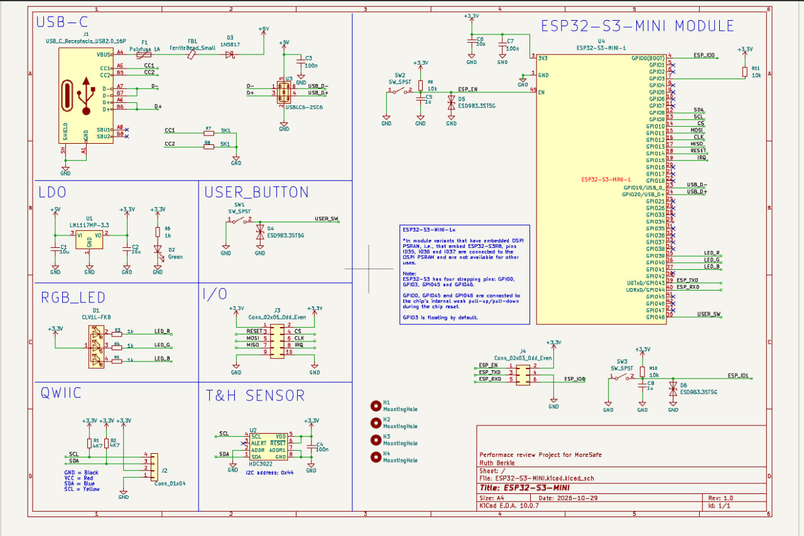
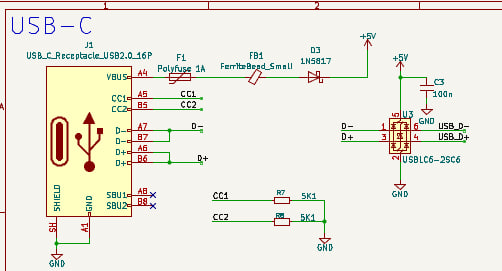
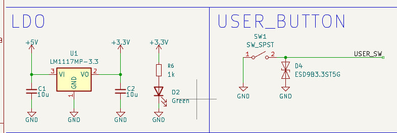
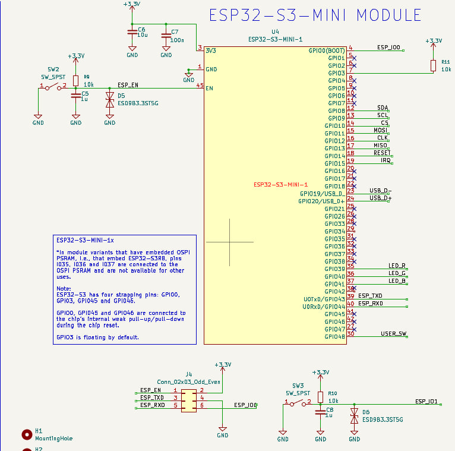
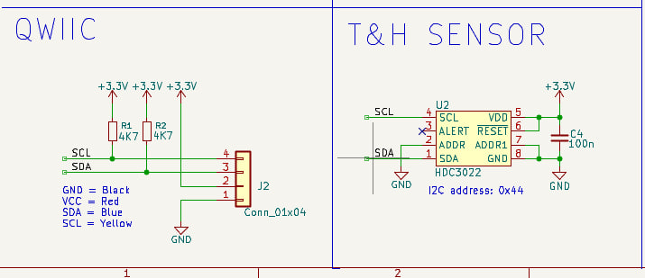
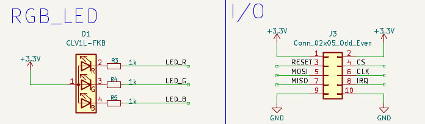
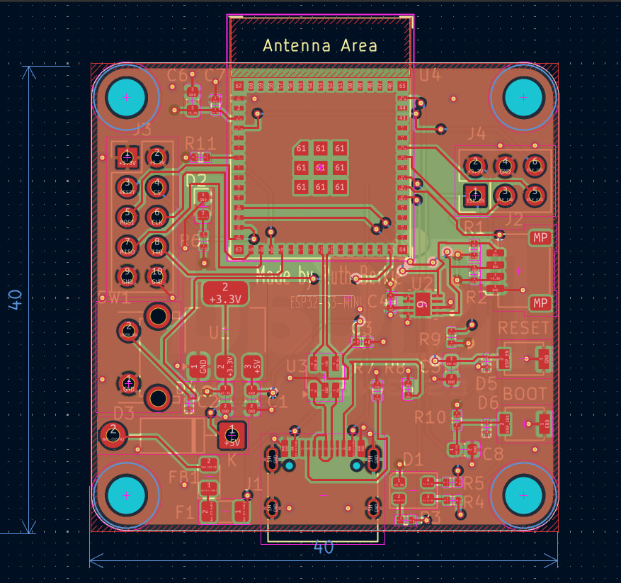
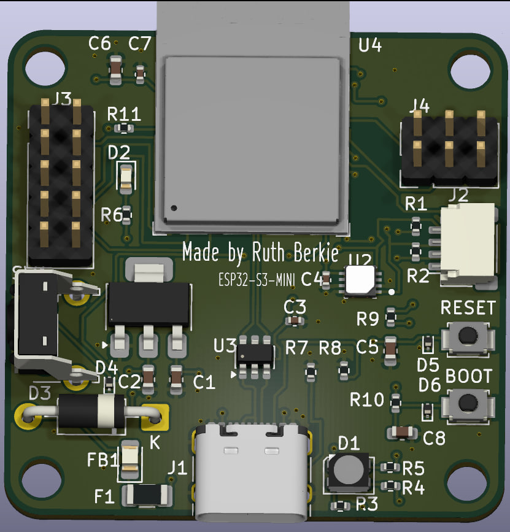

The Complete End-to-End System Rationale

This is a comprehensive, sequential summary of how all 6 functional blocks connect, interact, and operate dynamically as a unified system. It is structured in the exact order that electricity and data flow through the board—from the moment the plug is plugged in a cable to the execution of software tasks.
 
                       [1. USB-C Input & ESD] ───> [2. Power Conditioning (LDO)] ───> [3. 3.3V System Rails Active]
                                                                                                 │
                          ┌──────────────────────────────────────────────────────────────────────┘
                          │
                          ▼
                      [4. ESP32-S3 Boot up Sequence] <─── [RC Delay Network (10ms Lock)]
                          │
                          ├───> [5. Environmental Telemetry Bus] ───> Reading Onboard HDC3022 Sensor & Qwiic Port
                          │
                          ├───> [6. Peripheral Interaction Arrays] ──> Driving Common-Anode RGB LED Matrix
                          │
                          └───> [7. High-Speed External Expansion] ──> Driving Industrial 10-Pin SPI/IRQ Interface

Step 1: Power Entry, Handshaking, and Frontline Protection 
The entire operational sequence begins at J1 (the USB-C port).

    1. The Power Handshake: When a modern USB-C to USB-C cable is used, the host charger inspects the configuration channel pins (CC1/CC2). Because the 5.1 kΩ pull-down resistors is placed (R7/R8) on these lines, the charger identifies the board as a safe power sink and turns on its 5V rail.
    2. First Line of Defense (ESD): As the user inserts the cable, any invisible static electricity shock from their fingers is instantly intercepted by U3 (the USBLC6-2SC6 TVS diode array), which clamps the high voltage and dumps it safely to the ground plane before it can enter the rest of the board.
    3. Overcurrent Intercept: The raw 5V power travels through F1 (the 1A Polyfuse). If a downstream component is shorted, this fuse heats up and chokes the current to protect your computer's USB port.
    4. Noise Choking: The electricity then passes through FB1 (the Ferrite Bead), which blocks high-frequency electronic ripple from the laptop's power adapter, providing clean, smooth 5V power to the next stage.
    5. Reverse Voltage Isolation: Finally, D3 (the Schottky Diode) acts as a one-way check valve, letting this clean 5V travel onward but preventing any external programmer power from leaking backward into your computer.

Step 2: Power Conditioning and Voltage Regulation(Picture 5) 
The filtered 5V power now reaches U1 (the LM1117-3.3 Linear Regulator).

    1. Bulk Smoothing: C1 (10µF) acts as an entry reservoir, absorbing any sudden voltage shifts right at the door of the regulator.
    2. Down-Step Regulation: U1 takes the 5V and steps it down to a stable +3.3V, burning off the extra 1.7V as heat. This 3.3V line is the primary power source for all computer chips on the board.
    3. Transient Buffering: C2 (10µF) acts as an output reservoir. When downstream chips suddenly pull large currents, C2 dumps its energy into the rail instantly to keep the voltage from dropping.
    4. Visual Diagnostics: The moment the 3.3V rail stabilizes, current travels through R6 to light up D2 (the Green LED), providing a visual confirmation that the board's power system is operating correctly.

Step 3: Hardware Boot, Clock Timing, and Brain Management
With 3.3V spreading across the inner power planes of the board, the U4 (ESP32-S3-MINI-1) module wakes up.

    1. The Startup Delay: To prevent the ESP32 from turning on during mid-voltage fluctuations, R9 (10kΩ) and C5 (1µF) form an RC delay network. They force the EN (Reset) pin to stay low for exactly 10 milliseconds, holding the processor core in a reset state until the 3.3V rail is entirely stable.
    2. Boot Mode Selection: As the 10ms timer expires and the EN pin pulls high, the ESP32 looks at its configuration "strapping pins":
	• Normal Operation: If SW3 (BOOT button) is sitting idle, GPIO0 is pulled high internally, and the chip boots straight into its flash memory to run your saved code.
	• Flashing Mode: If you hold SW3 down while tapping SW2 (RESET), GPIO0 drops to 0V (Ground). The chip detects this and switches into its download mode, allowing a computer connected via the J4 Programming Header to upload a new script over the ESP_TXD and ESP_RXD serial lines.
    3. Noise Stability: Local 10µF (C6) and 100nF (C7) decoupling capacitors sit right at the ESP32's power pins, acting as high-frequency filters to absorb voltage fluctuations caused by the processor's internal transistors.
    4. Boot Rule Adherence: R11 (the external 10kΩ pull-up) keeps GPIO3 locked safely at 3.3V, satisfying the Espressif datasheet note to prevent a floating state from causing unpredictable boot failures.

Step 4: Environmental Data Collection via the Telemetry Bus (Picture 7)
Once the ESP32-S3 code begins running, it initializes its internal I2C communication peripheral mapped to pins 12 and 13.

    1. Line Stabilization: R1 (4.7kΩ) and R2 (4.7kΩ) act as active pull-ups, holding the SDA (Serial Data) and SCL (Serial Clock) lines at 3.3V so they don't drift into electrical noise.
    2. Onboard Telemetry: The ESP32 acts as the master, pulsing the SCL line to establish a clock rhythm. It addresses U2 (the HDC3022 sensor) using its hardwired I2C address (0x44, established by grounding its address selection pins). The sensor reads local relative humidity and temperature, sending the digital results back along the SDA line. C4 (100nF) ensures that high-precision analog measurements inside U2 are shielded from digital board noise.
    3. Modular Expansion: Simultaneously, this exact same I2C bus routes out to J2 (the Qwiic connector), allowing you to daisy-chain external sensors into the exact same communication pipeline without soldering.

Step 5: User Feedback and Industrial Peripherals (Pictures 5 & 6)
With environmental data safely inside the processor, the ESP32 executes its final tasks: outputting information to the user and interacting with external hardware expansion modules.

    1. Visual Reporting (Picture 6): Based on the data received from the sensor, the ESP32 manages the status display using D1 (the Common-Anode RGB LED). Because the anode is tied directly to 3.3V, the ESP32 uses active-low logic: it pulls LED_R, LED_G, or LED_B down to Ground to complete the circuit. The 1kΩ series resistors (R3–R5) limit the current to prevent the LED from burning out. For example, if the temperature is safe, it pulls LED_G low to flash a green status light; if a sensor error occurs, it pulls LED_R low to turn on a red warning light.
    2. User Input Handling (Picture 5): The processor constantly monitors SW1 (the USER button) via the USER_SW trace. When a user physically presses the button, the trace drops to 0V. D4 (a TVS diode) protects the delicate microcontroller pin from any static electricity generated by the user's touch. The software reads this input change and can execute custom actions, such as changing the display color or cycling modes.
    3. High-Speed Industrial Output (Picture 6): For advanced hardware configurations, the ESP32 communicates with high-density components (like an external display or an SD storage array) broken out on J3 (the 10-pin expansion header). It pushes high-speed data synchronously over the MOSI, MISO, and CLK lines, controls device activation via CS, resets external modules via the RESET pin, and catches real-world hardware alerts instantly via the dedicated IRQ (Interrupt Request) input pin.

	  

The 4-Layer PCB Stackup

    LAYER 1: Top(F.Cu) ── Components, High-Speed Signals, RF Antenna Feed
                   - Thin prepreg isolation dielectric layer
    LAYER 2: Inner 1   ── Continuous Ground (GND) Plane (RF Return Path)
                   - Thick core material substrate
    LAYER 3: Inner 2   ── Dedicated Power (+3.3V) Plane (Low Inductance Distribution)
                   - Thin prepreg isolation dielectric layer
    LAYER 4: Bottom(B.Cu)  ── Auxiliary Signals, Mechanical Fills, Thermal GND Shielding

What is Done on Each Layer of Your Design

Layer 1: The Top Layer (F.Cu - Signal & Components)

    • What is on it: All the active components (ESP32-S3 module, HDC3022 sensor, LDO, switches,         and LEDs), component solder pads, and high-speed data interconnects.
    • Its Engineering Role: It contains your most critical, high-speed traces (such as the D+/D-         USB line pair and the SDA/SCL I2C lines). Keeping these lines on the top layer eliminates          the need to push them through vias, lowering parasitic capacitance and minimizing data             transmission errors.

Layer 2: Inner Layer 1 (In1.Cu - Continuous Ground Plane)

    • What is on it: A solid, continuous sheet of copper completely poured and dedicated to GND (Zero-Volt reference).
    • Its Engineering Role: This layer acts as a mirror directly underneath the Top Layer. Every electrical pulse traveling through a top trace creates a perfectly paired return current flowing through this ground plane. By leaving this inner plane completely unbroken, you eliminate electrical loops, dramatically lower board-level noise, and create a solid shielding floor for the 2.4GHz Wi-Fi antenna feed.

Layer 3: Inner Layer 2 (In2.Cu - Dedicated Power Plane)

    • What is on it: A solid copper plane completely poured and dedicated to the regulated +3.3V system power rail.
    • Its Engineering Role: When the ESP32 activates its Wi-Fi transmitter, it demands sharp bursts of current. Instead of choking that power through narrow, restrictive traces, the solid power plane distributes voltage like a massive highway, reducing voltage drops. Additionally, because the solid +3.3V plane sits directly parallel to the solid GND plane on Layer 2, they act as a massive structural capacitor, filtering out high-frequency switching noise automatically before it can distort your telemetry data.

Layer 4: The Bottom Layer (B.Cu - Auxiliary Routing & Thermal Shielding)

    • What is on it: Low-speed control lines (such as the manual switch routes), extra grounding fills, and the through-hole mechanical mounting pins of connectors like the USB-C port (J1).
    • Its Engineering Role: It acts as a safety valve for routing low-priority tracks that would otherwise clutter your top layer. The remaining empty space on this layer is filled with a secondary copper plane tied directly to Ground using a matrix of stitching vias. This layout configuration shields the inner signals from external radio frequency interference and draws thermal energy away from the linear regulator (U1) and the ESP32 processing core, letting the PCB act as a physical heat sink.

CONNECTIONS

1. Power & Core Ground Connections

       • Pin 3 (3V3): Connects directly to the inner +3.3V power plane (In2.Cu). This plane distributes power to the local decoupling capacitors (C6, C7), the LDO output (U1), the pull-up resistors (R1, R2, R9, R10, R11), the HDC3022 sensor (U2), the Qwiic port (J2), the RGB LED anode (D1), and the I/O expansions (J3, J4).
       • Pins 1, 45, and Center Thermal Pad (GND): Tie directly into the solid inner Ground plane (In1.Cu) through multiple stitching vias. This provides the 0V reference for every bypass capacitor, protection diode, and switch on the board.

2. Environmental Sensors & Modular Expansion (I2C Bus)

       • Pin 12 (GPIO8 / SDA) & Pin 13 (GPIO9 / SCL): These two pins form the shared I2C telemetry bus.
	   • They route horizontally to the right across the board to the HDC3022 Sensor (U2) (Pin 1 for SDA, Pin 4 for SCL).
	   • They continue to the right edge to hook into the Qwiic Connector (J2) (Pin 3 for SDA, Pin 4 for SCL).
	   • They are vertically pulled up to the 3.3V rail nearby via the 4.7kΩ resistors (R1, R2).

3. High-Speed System Expansion Header (J3 SPI Bus)

The left column of pins on the MCU module breaks out vertically to the 10-pin I/O expansion header (J3) on the left edge of the board:

    • Pin 14 (GPIO10 / CS): Routes directly to J3 Pin 4 (Chip Select control).
    • Pin 15 (GPIO11 / MOSI): Routes directly to J3 Pin 5 (Data Output line).
    • Pin 16 (GPIO12 / CLK): Routes directly to J3 Pin 6 (Serial Clock line).
    • Pin 17 (GPIO13 / MISO): Routes directly to J3 Pin 7 (Data Input line).
    • Pin 18 (GPIO14 / RESET): Routes to J3 Pin 3 to allow external device resetting.
    • Pin 19 (GPIO15 / IRQ): Routes to J3 Pin 8 for external hardware interrupt signaling.

4. Direct USB Data Interface (USB-C Programming)

       • Pin 23 (GPIO19 / USB_D-) & Pin 24 (GPIO20 / USB_D+): These high-speed differential lines route straight down the center of the board.
         	• They pass cleanly through the channels of the U3 ESD protection chip (USBLC6-2SC6).
         	• They land directly onto pins A7/B7 (D-) and A6/B6 (D+) of the USB-C port (J1) for native computer communication.

5. Status Diagnostics (RGB LED Matrix)

The right-hand GPIO block routes down towards the bottom right corner to drive the status indicator:

    • Pin 35 (GPIO38 / LED_R): Routes down to the current-limiting resistor R3, landing on D1 Pin 2 (Red Channel).
    • Pin 36 (GPIO39 / LED_G): Routes down to the current-limiting resistor R4, landing on D1 Pin 3 (Green Channel).
    • Pin 37 (GPIO40 / LED_B): Routes down to the current-limiting resistor R5, landing on D1 Pin 4 (Blue Channel).

6. Physical User UI Switches & Legacy Programming

       • Pin 27 (GPIO47 / USER_SW): Routes along the lower right-hand edge to the SW1 user switch circuit, protected by the D4 TVS diode.
       • Pin 45 (EN / Chip Reset): Routes to the RESET button (SW2), the R9/C5 10ms delay network, the D5 TVS diode, and Pin 1 of the J4 programming dock.
       • Pin 4 (GPIO0 / BOOT): Routes straight to the BOOT button (SW3), the R10/C8 debounce network, the D6 TVS diode, and Pin 6 of the J4 programming dock.
       • Pin 39 (GPIO43 / TXD) & Pin 40 (GPIO44 / RXD): These traditional UART serial lines route directly across to the 6-pin programming header (J4) (Pin 3 for TXD, Pin 5 for RXD) for automated lab debugging equipment.

   FINAL RESULT

